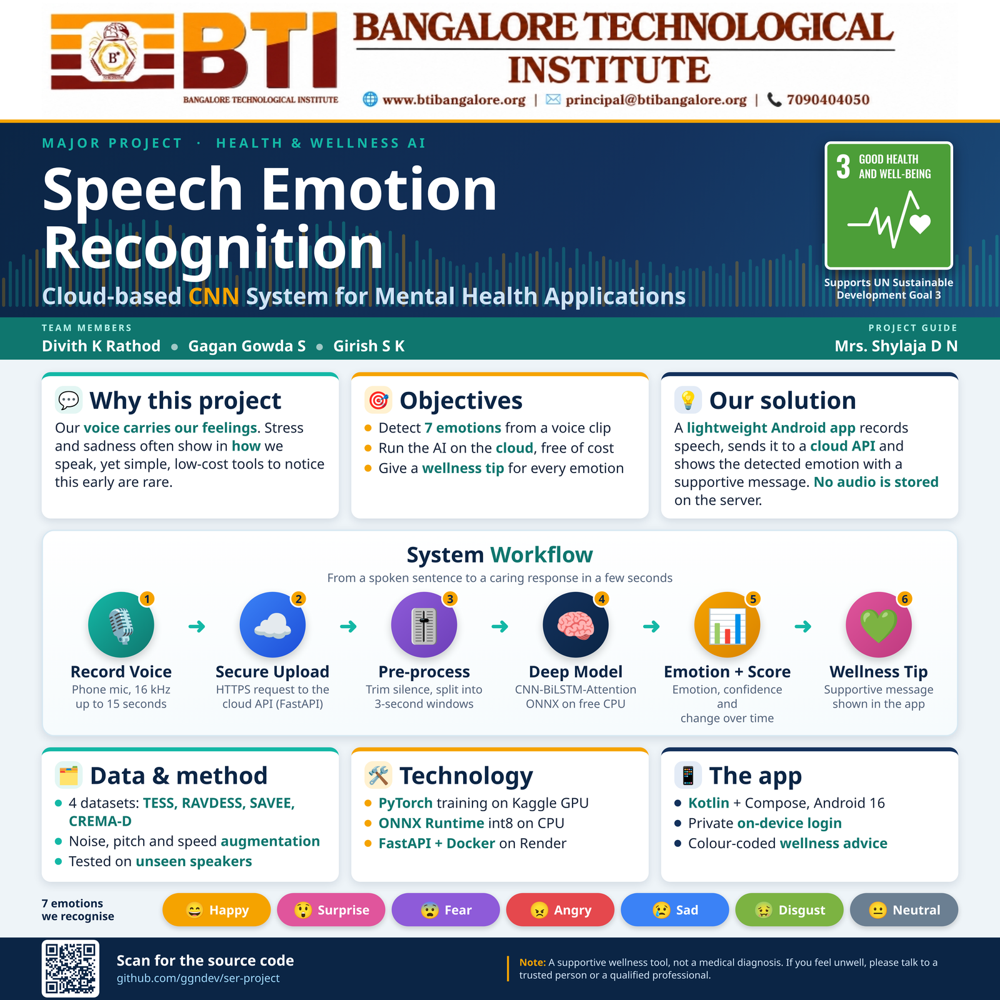
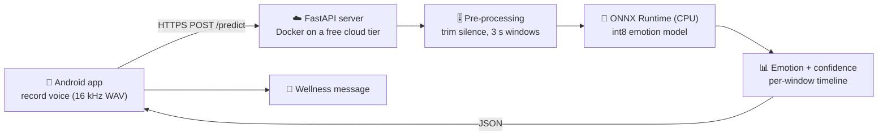
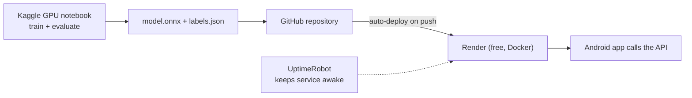

<div align="center">

# 🎙️ Speech Emotion Recognition for Mental Health & Wellness

**Record your voice, get the emotion it carries, and receive a caring wellness message, powered by a free cloud API and a lightweight Android app.**


-3DDC84?logo=android&logoColor=white)


</div>

<p align="center">
  
</p>

---

## 📌 Overview

Our voice carries our feelings. Stress and sadness often show in **how** we speak, yet simple, low-cost tools to notice this early are rare.

This project listens to a short voice recording, recognises **seven emotions** and answers with an emotion-specific wellness message. The deep-learning model runs on a **free cloud server** (no credit card needed), and a **lightweight Android app** records the voice and shows the result.

**Emotions recognised:** 😄 Happy · 😲 Surprise · 😨 Fear · 😠 Angry · 😢 Sad · 🤢 Disgust · 😐 Neutral

> ⚠️ This is a supportive wellness tool, **not a medical diagnosis**. If you feel unwell, please talk to a trusted person or a qualified professional.

## ✨ Features

- 🎤 **Record up to 15 seconds** of speech in the app
- 📈 **Per-window timeline** that shows when the tone of the voice changes
- 💚 **Wellness message for every emotion**, with gentle notes for sadness and low-confidence results
- 🔒 **On-device login** (register and sign in on the phone, passwords stored salted and hashed)
- ⚙️ **Settings screen** to point the app at your own server
- 🤫 **Silence gate**: silent or very quiet clips are rejected instead of guessed
- 🧱 **Stable by design**: crash reporter, Android 16 edge-to-edge support, tiny release app
- 💸 **Completely free to host**: Render free tier, GitHub auto-deploy, no card required

## 🏗️ Architecture





## 🧰 Tech stack

| Layer | Technology | Why |
|---|---|---|
| Model training | PyTorch, Kaggle free GPU | Free GPU hours, datasets hosted there |
| Models | CNN-BiLSTM-Attention and a pre-trained Wav2Vec2-base | A small model and a stronger transformer to compare |
| Export | ONNX, int8 dynamic quantisation | About 4x smaller, runs without PyTorch |
| API | FastAPI, ONNX Runtime, soundfile, soxr, NumPy | Light, CPU-only, quick start-up |
| Hosting | Docker on Render free tier, GitHub auto-deploy | Free, no card, HTTPS included |
| Mobile app | Kotlin, Jetpack Compose, OkHttp | Simple, modern, stable |
| API testing | Postman / Insomnia collection | Proves behaviour, including error cases |

## 📂 Repository structure

```
.
├── backend/          FastAPI + ONNX Runtime service (Dockerfile, model files, labels.json)
├── android/          Kotlin + Jetpack Compose app (Android Studio project)
├── apk/              Ready-to-install app builds
├── docs/             Detailed documentation: ML, backend, deployment, Android
├── postman/          API test collection and sample audio clips
├── tools/            Helper scripts (notebook and document generators)
├── ser_report_notebook.ipynb   Explained training notebook (Kaggle)
├── DEPLOY.md         Short deployment checklist
└── render.yaml       Render service definition
```

## 🚀 Getting started

### 1. Run the API locally

```bash
cd backend
pip install -r requirements.txt
uvicorn app:app --port 8000      # needs backend/model/model.onnx and labels.json
```

Open `http://localhost:8000/docs` to try `/predict` by uploading a WAV file. Details: [backend/README.md](backend/README.md).

### 2. Deploy for free

Push the repository to GitHub, create a **Render** web service (Docker, free plan, root directory `backend`), and optionally add an **UptimeRobot** ping on `/health`. Step by step: [DEPLOY.md](DEPLOY.md) and [docs/03-deployment](docs/03-deployment/README.md).

### 3. Get the Android app

- **Install directly:** download [`apk/EmoSense-release.apk`](apk/EmoSense-release.apk) on an Android phone and allow installation from your browser or file manager.
- **Build it yourself:** open the `android/` folder in Android Studio (JDK 17) and run the app. Details: [android/README.md](android/README.md).

In the app, create an account on the device, then open ⚙ **Settings** and enter the address of your own deployed server.

## 📚 Documentation

| Topic | Link |
|---|---|
| Documentation home | [docs/README.md](docs/README.md) |
| Machine learning (data, preprocessing, models, training, export) | [docs/01-ml](docs/01-ml/README.md) |
| Backend API, line by line | [docs/02-backend](docs/02-backend/README.md) |
| Deployment, from model file to phone | [docs/03-deployment](docs/03-deployment/README.md) |
| Android app | [docs/04-android](docs/04-android/README.md) |

## 🧭 Honest notes

- The free server **sleeps after 15 minutes** without traffic, so the first request can take about a minute. A health-check ping reduces this.
- A free CPU takes several seconds per 3-second window, so long recordings need patience.
- The training datasets contain **acted** emotions; real-life speech is harder, and results on speakers the model has never heard are lower than on a random split. We evaluate with both protocols for this reason.
- The API is open (no authentication) because this is a demo; the app's login only protects the app screens.

## 🗂️ Datasets

[TESS](https://tspace.library.utoronto.ca/handle/1807/24487), [RAVDESS](https://zenodo.org/record/1188976), [SAVEE](http://kahlan.eps.surrey.ac.uk/savee/) and [CREMA-D](https://github.com/CheyneyComputerScience/CREMA-D). Each dataset keeps its own licence and terms; please read them before reuse. Dataset audio is not included in this repository.

## 👥 Team

**Major project** at **Bangalore Technological Institute**, aligned with **UN Sustainable Development Goal 3: Good Health and Well-being**.

| Role | Name |
|---|---|
| Team member | Divith K Rathod |
| Team member | Gagan Gowda S |
| Team member | Girish S K |
| Project guide | Mrs. Shylaja D N |

## 🙏 Acknowledgements

Thanks to the creators of the four emotional-speech datasets, the open-source communities behind PyTorch, Hugging Face Transformers, ONNX Runtime, FastAPI and Jetpack Compose, and the free tiers of Kaggle, GitHub, Render and UptimeRobot that made a zero-cost deployment possible.
